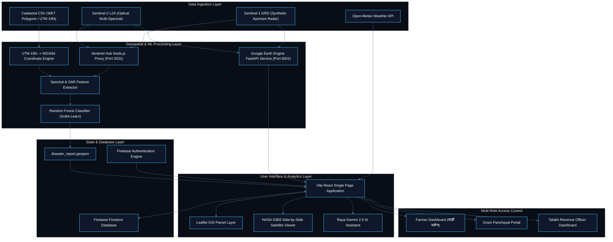
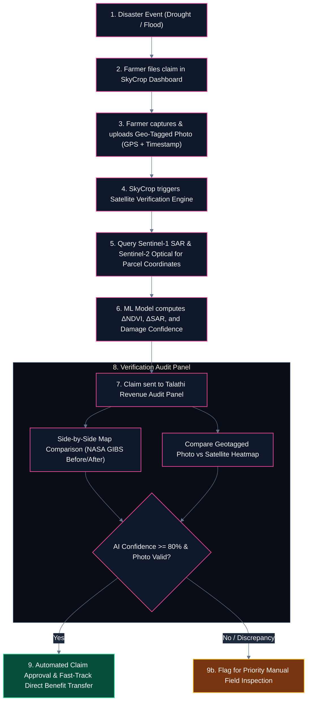

# Guardian: Satellite-Powered Agricultural Disaster Detection and Cadastral Intelligence

Guardian is an enterprise-grade geospatial intelligence and disaster detection platform designed to revolutionize agricultural risk assessment, crop health monitoring, and insurance verification across Maharashtra, India. By fusing multi-spectral optical satellite imagery (**Sentinel-2**) with Synthetic Aperture Radar (**Sentinel-1 SAR**), Guardian provides automated, parcel-level disaster classification (Drought, Flood, or Healthy) and eliminates the traditional ground-truth verification gap.

---

## Executive Summary and Problem Statement

### The Problem
In traditional agricultural systems, assessing crop damage following natural disasters (droughts, unseasonal floods, monsoon failures) relies on manual field surveys known as *Talathi Panchnama*. This process faces severe challenges:
- **Delayed Compensation**: Manual surveys take weeks or months to complete, leaving vulnerable farmers without financial relief.
- **Subjectivity and Human Error**: Ground observations vary drastically between individual assessors.
- **High Administrative Overhead**: Field officers must manually visit thousands of scattered cadastral plots.
- **Fraud and Discrepancies**: Lack of verifiable historical satellite evidence leads to dispute-prone insurance claims.

### The Solution
Guardian replaces slow, manual workflows with an automated, space-grade geospatial pipeline. By leveraging satellite sensors that observe Earth continuously, Guardian offers:
- **Instant Parcel Analysis**: Automated classification of individual cadastral plots (*Gat Numbers*) within seconds.
- **Cloud-Penetrating Radar**: Sentinel-1 SAR imagery enables flood and water anomaly detection even through heavy monsoon cloud cover.
- **Dual-Layer Vegetation Tracking**: Sentinel-2 multi-spectral bands measure chlorophyll density and vegetation stress via NDVI deltas.
- **Bilingual Accessibility**: Full English and Marathi localization (*मराठी भाषा अंतरपृष्ठ*) tailored for local farmers, Gram Panchayat officials, and Talathi revenue officers.

---

## Platform Conceptual Overview

### Simple Conceptual Explanation (For Non-Technical Stakeholders)
1. **Cadastral Plot Mapping**: A farmer or revenue officer enters a official land record plot number (*Gat No*).
2. **Satellite Overhead Look**: SkyCrop queries orbit satellites passing overhead over the selected coordinates.
3. **Health and Water Measurement**:
   - **Greenness Test**: The system measures how green and healthy the crop is compared to 3 months ago. A sudden drop indicates drought.
   - **Water Sensor Test**: The radar sensor bounces signals off the ground. Standing water acts like a mirror, causing a sudden signal drop. This identifies flooded fields even on rainy, cloudy days.
4. **Automated Risk Scoring**: The AI combines these signals to instantly determine if the land is Healthy, Drought-affected, or Flooded.
5. **Instant Insurance Verification**: The officer compares the satellite report against farmer-uploaded geo-tagged photos and approves compensation instantly.

### Complex Technical Architecture (For Engineers and Data Scientists)
1. **Cadastral Boundary Ingestion**: Ingests cadastral land records containing UTM Zone 43N (EPSG:32643) WKT geometries.
2. **Coordinate Transformation Engine**: Converts Easting and Northing coordinates to WGS84 (EPSG:4326) latitude and longitude using Ellipsoidal Transverse Mercator projection math.
3. **Multi-Spectral and SAR Fusion**:
   - Extracts baseline ($T_{-1}$) and current ($T_0$) median reflectance from Sentinel-2 L2A and backscatter power from Sentinel-1 GRD.
   - Computes normalized vegetation indices ($NDVI$) and logarithmic radar backscatter ($\sigma^0 \text{ dB}$).
   - Derives spectral delta features ($\Delta NDVI$, $\Delta SAR$).
4. **Machine Learning Classifier**: Trains a Random Forest Classifier with balanced class weights to assign class probabilities ($P(\text{Healthy}), P(\text{Drought}), P(\text{Flood})$) and confidence metrics.
5. **Decoupled Service Stack**:
   - **FastAPI GEE Microservice**: Executes server-side Google Earth Engine spatial reductions.
   - **Node.js Sentinel Proxy**: Solves browser CORS constraints and handles OAuth2 token cycling for Sentinel Hub Process API requests.
   - **Vite React Frontend**: Delivers real-time Leaflet GIS mapping, side-by-side NASA GIBS satellite view, and Firebase Firestore state synchronization.

---

## System Architecture



---

## Machine Learning Pipeline and Spectral Analysis

### Coordinate Transformation Math
Cadastral survey geometries in Maharashtra are recorded in UTM Zone 43N (EPSG:32643). SkyCrop converts these Easting ($E$) and Northing ($N$) coordinates into WGS84 Latitude ($\phi$) and Longitude ($\lambda$) using Transverse Mercator ellipsoid equations:

$$M = \frac{N}{k_0}$$

$$\mu = \frac{M}{a(1 - \frac{e^2}{4} - \frac{3e^4}{64} - \frac{5e^6}{256})}$$

$$\phi_1 = \mu + \left(\frac{3e_1}{2} - \frac{27e_1^3}{32}\right)\sin(2\mu) + \left(\frac{21e_1^2}{16} - \frac{55e_1^4}{32}\right)\sin(4\mu) + \left(\frac{151e_1^3}{96}\right)\sin(6\mu)$$

$$D = \frac{E - 500000}{N_1 k_0}$$

### Spectral Indices and Formulas

#### 1. Normalized Difference Vegetation Index (NDVI)
NDVI measures photosynthetic active radiation and chlorophyll absorption using Sentinel-2 Near-Infrared (Band 8) and Red (Band 4):

$$\text{NDVI} = \frac{\text{B08 (NIR)} - \text{B04 (Red)}}{\text{B08 (NIR)} + \text{B04 (Red)} + \epsilon}$$

- **Healthy Crop**: $\text{NDVI} \ge 0.55$
- **Stressed / Sparse Crop**: $0.25 \le \text{NDVI} < 0.55$
- **Drought / Bare Soil**: $\text{NDVI} < 0.25$

#### 2. Synthetic Aperture Radar (SAR) Backscatter
Sentinel-1 C-band SAR measures radar backscatter intensity in VV polarization. The raw linear power is converted to decibels ($\text{dB}$):

$$\sigma^0 (\text{dB}) = 10 \cdot \log_{10}(\text{VV} + \epsilon)$$

- **Specular Reflection (Standing Water / Flood)**: Smooth open water reflects radar signals away from the satellite sensor, causing $\sigma^0$ to drop severely ($\sigma^0 < -18 \text{ dB}$, $\Delta \text{SAR} < -6 \text{ dB}$).
- **Rough Soil / Vegetated Ground**: $\sigma^0$ ranges between $-12 \text{ dB}$ and $-7 \text{ dB}$.

#### 3. Delta Feature Extraction
To account for regional baseline variations, SkyCrop calculates changes between baseline historical dates ($T_{-1}$) and post-event observation dates ($T_0$):

$$\Delta \text{NDVI} = \text{NDVI}_{T_0} - \text{NDVI}_{T_{-1}}$$

$$\Delta \text{SAR} = \text{SAR}_{T_0} - \text{SAR}_{T_{-1}}$$

### Machine Learning Classification Pipeline

```mermaid
%%{init: {
  'theme': 'base',
  'themeVariables': {
    'fontFamily': 'Inter, system-ui, sans-serif',
    'primaryColor': '#0f172a',
    'primaryTextColor': '#f8fafc',
    'primaryBorderColor': '#10b981',
    'lineColor': '#64748b',
    'secondaryColor': '#1e293b',
    'tertiaryColor': '#0f172a',
    'clusterBkg': '#090d16',
    'clusterBorder': '#334155'
  }
}}%%
flowchart LR
    subgraph Data_Preparation ["1. Data Preparation"]
        RAW["Land Survey CSV"] --> PARSE["UTM Zone 43N Parsing"]
        PARSE --> WGS["WGS84 Centroid & Ring Polygon"]
    end

    subgraph Feature_Engineering ["2. Feature Engineering"]
        WGS --> QUERY_S2["Fetch Sentinel-2 Bands B04, B08"]
        WGS --> QUERY_S1["Fetch Sentinel-1 Band VV"]
        QUERY_S2 --> CALC_NDVI["Compute Baseline & Current NDVI"]
        QUERY_S1 --> CALC_SAR["Compute Baseline & Current SAR (dB)"]
        CALC_NDVI --> DELTA["Calculate Delta NDVI & Delta SAR"]
        CALC_SAR --> DELTA
    end

    subgraph ML_Training ["3. Random Forest Model"]
        DELTA --> VECTOR["Feature Vector: [NDVI_b, NDVI_c, ΔNDVI, SAR_b, SAR_c, ΔSAR]"]
        VECTOR --> SCALER["StandardScaler Normalization"]
        SCALER --> TRAIN["Random Forest Classifier (300 Trees, Depth 8-10)"]
    end

    subgraph Output_Generation ["4. Disaster Report Export"]
        TRAIN --> PREDICT["Predict Class & Confidence Score"]
        PREDICT --> OUTPUT["Generate disaster_report.geojson & disaster_sample.json"]
    end

    classDef default fill:#0f172a,stroke:#10b981,stroke-width:1.5px,color:#f8fafc;
    classDef highlight fill:#064e3b,stroke:#34d399,stroke-width:1.5px,color:#ffffff;
```



---

## Real-Time Microservices and API Architecture

SkyCrop implements two backend microservices to interface with satellite infrastructure:

### 1. Google Earth Engine (GEE) FastAPI Microservice (`gee_service/main.py`)
- **Framework**: Python FastAPI running on Uvicorn (`http://localhost:8001`).
- **Authentication**: Service Account credentials with Google Earth Engine SDK.
- **Operation**: Receives a `gat_no`, parses WKT polygon geometry, queries `COPERNICUS/S2_SR_HARMONIZED` (cloud masked via QA60 band) and `COPERNICUS/S1_GRD` ImageCollections, and performs `reduceRegion` mean aggregations.
- **AI Integration**: Integrates Google Gemini 2.5 Flash Lite (`gemini-2.5-flash-lite`) to power **Raya**, the bilingual agricultural AI assistant.

### 2. Sentinel Hub Node.js OAuth Proxy (`sentinel_proxy.js`)
- **Framework**: Express.js server running on `http://localhost:3031`.
- **CORS Management**: Solves browser cross-origin restrictions by relaying requests to Copernicus Dataspace OpenID Connect endpoint.
- **Custom Evalscripts**:
  - **NDVI Script**: Renders true multi-spectral NDVI map tiles with custom color ramps (Red = burnt/drought, Yellow = stressed, Green = healthy).
  - **SAR Script**: Normalizes decibel ranges ($-25 \text{ dB}$ to $0 \text{ dB}$) into high-contrast blue-scale water hazard heatmaps.
  - **True Color Script**: Applies gain-adjusted RGB reflectance rendering ($B04, B03, B02$).

```mermaid
%%{init: {
  'theme': 'base',
  'themeVariables': {
    'fontFamily': 'Inter, system-ui, sans-serif',
    'primaryColor': '#0f172a',
    'primaryTextColor': '#f8fafc',
    'primaryBorderColor': '#f59e0b',
    'lineColor': '#64748b',
    'secondaryColor': '#1e293b',
    'tertiaryColor': '#0f172a',
    'clusterBkg': '#090d16',
    'clusterBorder': '#334155'
  }
}}%%
sequenceDiagram
    autonumber
    actor User as Dashboard / React App
    participant Proxy as Sentinel Proxy (Port 3031)
    participant GEE as GEE FastAPI (Port 8001)
    participant Auth as Copernicus Auth / GEE Auth
    participant Copernicus as Copernicus Dataspace API
    participant EarthEngine as Google Earth Engine Cloud

    rect rgb(15, 23, 42)
        note over User, Copernicus: Path A: Real-Time Custom Map Tiles (Sentinel Proxy)
        User->>Proxy: GET /sentinel?lat=17.39&lon=74.09&type=ndvi
        Proxy->>Auth: Request OAuth2 Access Token
        Auth-->>Proxy: Return Bearer Access Token
        Proxy->>Copernicus: POST /api/v1/process (Evalscript + BBox)
        Copernicus-->>Proxy: Return PNG Tile Buffer
        Proxy-->>User: Render PNG Overlay on Leaflet Map
    end

    rect rgb(30, 41, 59)
        note over User, EarthEngine: Path B: On-Demand Parcel Assessment (GEE Microservice)
        User->>GEE: POST /api/analyze { gat_no: "142" }
        GEE->>GEE: Parse WKT -> UTM 43N to WGS84 Polygon
        GEE->>EarthEngine: Query S2_HARMONIZED + S1_GRD ImageCollections
        EarthEngine-->>GEE: Return mean NDVI and mean SAR VV stats
        GEE->>GEE: Run Classification Logic (Status + Confidence)
        GEE-->>User: Return AnalyzeResponse JSON
    end
```



---

## Multi-Role Dashboard Capabilities

SkyCrop provides a role-tailored dashboard supporting three distinct user profiles:

| Role | Target User | Key Capabilities | Marathi Interface Label |
| :--- | :--- | :--- | :--- |
| **Farmer** | Individual Landowner / Cultivator | Land registration (*Gat No*), crop health monitoring, local weather forecasts, instant insurance claim filing with geotagged ground photos. | माझी जमीन |
| **Gram Panchayat** | Village Governance Officials | Village-level aggregated crop health summaries, emergency relief distribution tracking, localized weather hazard warnings. | स्थानिक स्वराज्य |
| **Talathi** | Land Records & Revenue Officers | GIS cadastral layer review, dual side-by-side satellite map comparison, verification of farmer claims against AI satellite ground-truth. | महसूल अधिकारी |

---

## Automated Insurance Claim Verification Workflow

The end-to-end insurance verification workflow bridges the gap between field evidence and satellite verification:



---

## Technical Stack

- **Frontend Core**: React 18, Vite, React Router v6
- **Styling & Components**: Tailwind CSS, Vanilla CSS Glassmorphism
- **Mapping & GIS**: Leaflet.js, React-Leaflet, NASA GIBS Web Map Tile Service (WMTS)
- **Backend & Database**: Firebase Authentication, Cloud Firestore Real-Time Database
- **Geospatial Microservices**: Python FastAPI, Uvicorn, Express.js (Node.js)
- **Machine Learning & Analytics**: Scikit-Learn, Pandas, NumPy, Shapely, GeoPandas
- **Satellite Data Providers**: Copernicus Dataspace Ecosystem (Sentinel-1 SAR, Sentinel-2 L2A), Google Earth Engine API
- **AI & NLP**: Google Gemini 2.5 Flash Lite API (`google-generativeai`)
- **Weather Services**: Open-Meteo Weather Forecast API

---

## Directory Structure

```
SkyCrop-main/
├── README.md                           # Master Project Documentation
├── disaster_pipeline.py                # Machine Learning Pipeline (Random Forest & UTM Transformer)
├── sentinel_pipeline.py                # Copernicus Dataspace Real Sentinel API Ingestion
├── sentinel_proxy.js                   # Node.js Sentinel Hub OAuth Proxy Server
├── features.txt                        # Capability Specifications
├── disaster_report.geojson             # Standard GeoJSON Disaster Output (EPSG:4326)
├── backend/                            # Django Backend Skeleton
├── gee_service/                        # Google Earth Engine Microservice
│   ├── main.py                         # FastAPI App (GEE Processing & Gemini Chatbot)
│   └── requirements.txt                # Microservice Python Dependencies
├── dashboard/                          # Main React Application
│   ├── package.json                    # Dashboard Dependencies & Scripts
│   ├── vite.config.js                  # Vite Configuration
│   ├── firestore.rules                 # Security Rules for Firestore Database
│   └── src/
│       ├── App.jsx                     # Application Main Router & Auth Handler
│       ├── firebase.js                 # Firebase Client SDK Configuration
│       ├── components/
│       │   ├── Layout.jsx              # Application Shell & Navigation
│       │   ├── GeoTagPhoto.jsx         # Camera & GPS Geo-Tagging Component
│       │   └── RayaChat.jsx            # Gemini AI Chat Interface Component
│       ├── pages/
│       │   ├── Home.jsx                # Landing & Overview Dashboard
│       │   ├── MyLand.jsx              # Land Parcel Registration & Monitoring
│       │   ├── Weather.jsx             # Open-Meteo Weather Insights
│       │   ├── NDVIHealth.jsx          # Crop Health & Vegetation Index Maps
│       │   ├── DisasterVerification.jsx# Dual-Map Satellite Verification Engine
│       │   ├── InsuranceClaims.jsx     # Insurance Claims & Audit Trail Portal
│       │   ├── Profile.jsx             # User Role & Regional Profile Settings
│       │   └── data/
│       │       └── land_satara.csv     # Cadastral Survey Land Records Dataset
│       └── i18n/                       # Localization Strings (English & Marathi)
└── docs/                               # Documentation & Assets
```

---

## Installation and Setup Guide

### Prerequisites
- **Node.js**: v18.0.0 or higher
- **Python**: v3.10 or higher
- **Pip**: Package manager for Python

---

### Step 1. Clone Repository and Environment Setup

```bash
git clone https://github.com/TejasKadam001/SkyCrop.git
cd SkyCrop-main
```

---

### Step 2. Run Python Disaster Classification Pipeline

To run the offline ML model and generate `disaster_report.geojson`:

```bash
# Install Python dependencies
pip install pandas geopandas shapely scikit-learn numpy requests

# Execute ML pipeline
python3 disaster_pipeline.py
```

Expected Output:
```
[1/5] Loading cadastral data from land_satara.csv
[2/5] Simulating Sentinel-2 NDVI + Sentinel-1 SAR acquisition...
[3/5] Computing delta features...
[4/5] Training Random Forest Classifier...
[5/5] Generating disaster_report.geojson...
      Done. Output saved to disaster_report.geojson
```

---

### Step 3. Launch Google Earth Engine Microservice (Optional)

To start the FastAPI real-time GEE backend:

```bash
cd gee_service
pip install -r requirements.txt
uvicorn main:app --reload --host 0.0.0.0 --port 8001
```

The service will run on `http://localhost:8001`. Test endpoints:
- Health Check: `http://localhost:8001/health`
- API Documentation: `http://localhost:8001/docs`

---

### Step 4. Launch Sentinel Hub Proxy Server (Optional)

To proxy live Sentinel Hub process imagery:

```bash
# Install Node dependencies in workspace root
npm install express node-fetch

# Start proxy server
node sentinel_proxy.js
```

The proxy will run on `http://localhost:3031`.

---

### Step 5. Launch Dashboard Web Application

```bash
# Navigate to dashboard directory
cd dashboard

# Install dependencies
npm install

# Start Vite development server
npm run dev
```

Open your browser and navigate to `http://localhost:5173`.

---

## Impact and Future Roadmap

- **Reduction in Payout Times**: Cuts insurance claim settlement cycles from 90+ days down to under 48 hours.
- **Cadastral Coverage Expansion**: Expanding cadastral land survey integration across all 36 districts of Maharashtra.
- **Yield Prediction Models**: Training multi-temporal Deep Learning (LSTM/Transformer) models for pre-harvest crop yield estimation.
- **Autonomous Drone Integration**: Integrating high-resolution multispectral UAV drone imagery for micro-level pest and nutrient management.

---

Designed and developed by team Lazy Loopers for agricultural resilience and disaster risk reduction.
# Fusion 2026
